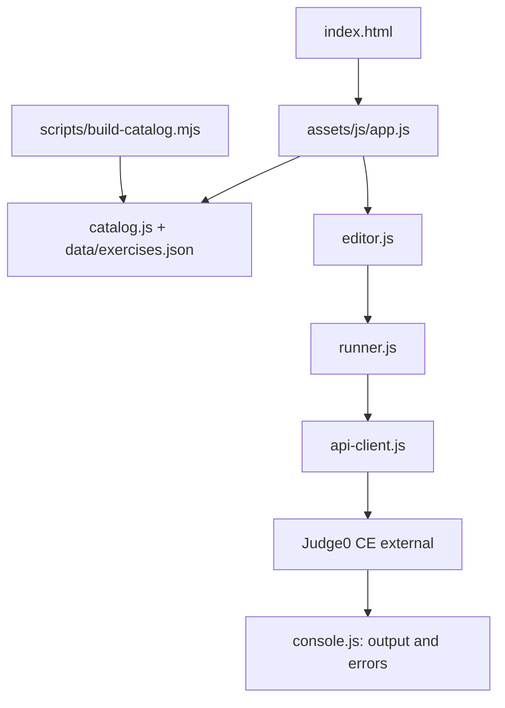

# Java Lab

Biblioteca web estática para consultar, editar e executar cópias dos exercícios Java de [ETEC-Desenvolvimento-de-Sistemas](https://github.com/Lvc4br/ETEC-Desenvolvimento-de-Sistemas). A aplicação principal fica na raiz do repositório.

## Arquitetura

## Arquitetura



`index.html` carrega os módulos em `assets/js/`: `app.js` coordena a interface; `catalog.js` lê e filtra os exercícios; `editor.js` permite alterar uma cópia do código; `runner.js` adapta o código e aplica limites; `api-client.js` chama o executor; `console.js` apresenta a saída e os erros; `router.js` controla a navegação. `data/exercises.json` é gerado por `scripts/build-catalog.mjs`.

Fluxo: catálogo → código original carregado do GitHub → edição local → adaptação → envio ao Judge0 CE → resultado no painel. O código editado não altera o arquivo original.

## Executar

Requisitos: Node.js, npm e internet.

```bash
npm install
npm run catalog
npm run dev
npm test
```

Execute os comandos na raiz. Abra o endereço mostrado pelo Vite, normalmente `http://127.0.0.1:5173`. Os módulos precisam ser servidos por HTTP.

## Executor

A configuração da raiz usa `https://ce.judge0.com`, language ID `91` (Java JDK 17), timeout de 20 segundos, limite de 50.000 bytes de código, limite de 5.000 bytes de stdin e intervalo mínimo de 3 segundos entre execuções. O serviço público pode impor limites ou ficar indisponível. A entrada é pré-enviada; não há terminal interativo.

## Cópia adicional e decisão de manutenção

Existe outra aplicação independente em `java-lab/`, com seu próprio `package.json`, configuração, catálogo e testes. Nessa cópia o endpoint do executor está vazio por padrão, portanto ela não executa até ser configurada. **A aplicação da raiz é a versão canônica recomendada** porque é a documentada e já contém a configuração do executor. A cópia `java-lab/` foi preservada nesta etapa para evitar apagar código sem comparar funcionalidade e histórico; antes de removê-la, compare diferenças e migre qualquer melhoria exclusiva para a raiz.

## Testes e limites

O workflow `.github/workflows/ci.yml` instala dependências, gera o catálogo e executa os testes da aplicação da raiz em pushes e pull requests. O resultado só pode ser considerado validado depois que o GitHub Actions concluir uma execução.

Os testes existentes cobrem partes do catálogo e do runner, não garantem a disponibilidade do serviço remoto. Não envie código sensível ao executor público. A pasta `backend/` contém apenas documentação de uma possível camada intermediária, não um servidor implementado.

**Autor:** Luca Toniolo — [@Lvc4br](https://github.com/Lvc4br)
